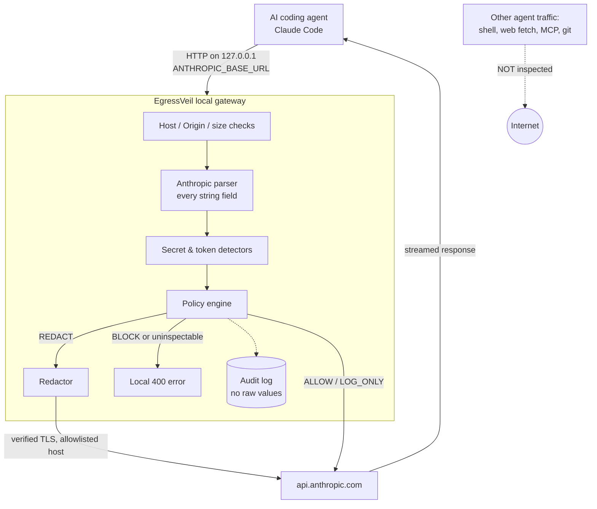

# EgressVeil

**The local privacy gateway for AI coding agents.**

[](https://github.com/qmmughal/egressveil/actions/workflows/ci.yml)
[](LICENSE)

EgressVeil is a local-first, open-source security gateway. It detects sensitive
information in the API traffic that supported AI coding agents send to LLM
providers, and redacts or blocks it before it leaves your machine.

**Free and open source, for everyone.** EgressVeil is released under the
[MIT License](LICENSE). You can use it, modify it, redistribute it and build
commercial products on it at no cost. There are no paid tiers, accounts,
license keys or usage limits. It runs entirely on your machine, has no
telemetry, and its only network connection is to the LLM provider you
configure.

> **Project status: pre-alpha.** EgressVeil runs as a local gateway for the
> **Anthropic Messages API** (Claude Code, Aider) and **OpenAI-compatible
> APIs** (Aider, OpenAI SDK-based agents). It detects **secrets, tokens,
> personal data and internal hostnames** and blocks or redacts them according
> to your policy. Detection is heuristic. Treat EgressVeil as one layer of
> defense, not a guarantee.

---

## Why

AI coding agents read your working tree and send large parts of it to a
remote LLM API. That context can contain `.env` files, cloud credentials,
customer data pasted into a test fixture, or internal hostnames. Today the
only control most teams have is to hope that none of it gets read.

EgressVeil sits between the agent and the provider API on `localhost`. It
inspects each request, applies a policy you control (`ALLOW`, `REDACT`,
`BLOCK`, `LOG_ONLY`), and writes an audit trail that never contains the raw
secret.

## What EgressVeil is not

- **It is not a firewall for everything your agent does.** It inspects only
  the LLM API traffic that a supported agent sends through it. Shell commands,
  package installs, web fetches, MCP servers, git pushes and other network
  activity from the agent or its tools are **not** covered.
- It cannot inspect traffic that an agent sends straight to a vendor backend
  that you can't redirect, which affects Cursor in particular (see
  [Integrations](#integration-compatibility)).
- It does not inspect responses from the model (planned).
- It is not a replacement for keeping secrets out of your repository.

See [docs/threat-model.md](docs/threat-model.md) for the full scope.

## Quick start

The easiest way to use EgressVeil is to launch your agent through it:

```bash
egressveil run -- claude          # Claude Code
egressveil run -- aider           # Aider (Anthropic or OpenAI models)
```

`egressveil run` starts the gateway if it isn't already running, points the
agent's `ANTHROPIC_BASE_URL` and `OPENAI_BASE_URL` at it, and stops the
gateway again when the agent exits. If you prefer to run the gateway
yourself, start it with `egressveil serve` and set the variables in another
terminal:

```bash
# Linux/macOS
export ANTHROPIC_BASE_URL=http://127.0.0.1:8787
claude
```

```powershell
# Windows PowerShell
$env:ANTHROPIC_BASE_URL = "http://127.0.0.1:8787"
claude
```

Claude Code keeps its own credentials. EgressVeil passes the auth header to
`api.anthropic.com` unchanged and never logs it.

If a request contains something your policy blocks, the request never leaves
your machine, and Claude Code shows an error like this:

```text
API Error: 400 EgressVeil: request blocked before leaving this machine:
sensitive data detected: secrets/aws_access_key_id at messages[4].content[0].content[0].text.
Remove the value from the conversation (for example start a new session)
or adjust the EgressVeil policy. (request ev_3c1f0a9e2b7d4c11)
```

> **Note on `BLOCK`:** Claude Code resends the whole conversation on every
> turn. Once a blocked value is in the conversation, every later request is
> blocked too, until you start a new session (for example with `/clear`). If
> you prefer to keep working, set the `secrets` and `tokens` rules to
> `REDACT`. The model then sees a placeholder such as
> `[EGRESSVEIL:aws_access_key_id:5b2e91c0]` instead of the value.

## Features

### Implemented

| Feature | Notes |
| --- | --- |
| `egressveil serve` | A local gateway for the Anthropic Messages API (`/v1/messages`, `/v1/messages/count_tokens`) and, under `/openai`, OpenAI-compatible APIs (`/v1/chat/completions`, `/v1/responses`, `/v1/completions`, `/v1/embeddings`). Streaming (SSE) is passed through |
| `egressveil run -- <agent>` | Launches an agent with its base URLs pointing at the gateway, starting and stopping the gateway as needed |
| Secret detectors | Anthropic, OpenAI, AWS, GitHub, GitLab, Slack, Stripe, Google, npm and Hugging Face keys; private keys; credentials in URLs; generic `password = "..."` and `.env` assignments |
| Token detectors | JWTs, bearer tokens and Basic auth headers |
| PII detectors | Email addresses, international and North-American phone numbers, US SSNs, payment cards (Luhn-checked) and IBANs (mod-97-checked). Example, test and no-reply addresses are ignored |
| Internal-hostname detector | Hosts under your `internal_domains`, plus `.internal`, `.corp`, `.intranet`, `.lan` and `.home.arpa`. Optionally private IPv4 addresses |
| Upstream proxy | `gateway.upstream_proxy: env` or an explicit proxy URL, for corporate networks |
| Policy engine | `ALLOW` / `REDACT` / `BLOCK` / `LOG_ONLY` for each detector. The most restrictive action wins |
| Redaction | Placeholders keyed by an HMAC of the value, so the same value always gets the same placeholder. That keeps conversations consistent and prompt caching effective. Redacted values are never restored |
| Fail-closed strict mode | Blocks unsupported endpoints, non-JSON or compressed bodies, malformed or duplicate-key JSON, too-deep nesting, uninspectable images and PDFs, and requests where a detector fails |
| Audit log | JSONL with request metadata, rule IDs, JSON locations and keyed digests. Never bodies, headers, query strings or raw values |
| Local hardening | Loopback-only listener. Host-header check against DNS rebinding. Browser `Origin` requests rejected. Upstreams are https-only and allowlisted, TLS is verified, and redirects are not followed |
| `egressveil scan` | Run the detectors and policy over files or stdin. Prints locations and rule IDs, never values |
| `egressveil doctor` | Checks Python, config, whether the gateway is running, an end-to-end self-test (a random canary credential must be blocked locally), the audit location, proxy settings, the base-URL environment variables, and the active detectors |
| `egressveil config validate` | A strict schema with secure defaults. Output never contains values |

### Planned

| Feature | Phase |
| --- | --- |
| OpenClaw integration | 3 |
| Cursor: documented, experimental support where technically possible | 3 |
| Response-side inspection | 3 |

The details are in [docs/roadmap.md](docs/roadmap.md).

## Security architecture



Each control, and whether it is implemented, is described in
[docs/security-design.md](docs/security-design.md).

## Installation

EgressVeil requires Python 3.11 to 3.14 and runs on Windows, macOS and Linux.

EgressVeil is published on [PyPI](https://pypi.org/project/egressveil/). The
recommended way to install it is with [pipx](https://pipx.pypa.io/), which
puts the CLI in its own isolated environment:

```bash
pipx install egressveil
```

Or with pip, into the virtual environment of your choice:

```bash
pip install egressveil
```

Releases are built and published only by GitHub Actions, with no stored
tokens. PyPI releases use [Trusted Publishing](https://docs.pypi.org/trusted-publishers/)
and carry PyPI attestations. The files on the
[Releases page](https://github.com/qmmughal/egressveil/releases) also have
signed build provenance, which you can verify with:

```bash
gh attestation verify egressveil-0.3.0-py3-none-any.whl --repo qmmughal/egressveil
```

To work on EgressVeil itself, install it from source:

```bash
git clone https://github.com/qmmughal/egressveil.git
cd egressveil
python -m venv .venv
# Windows:      .venv\Scripts\activate
# Linux/macOS:  source .venv/bin/activate
python -m pip install -e ".[dev]"
```

See [CONTRIBUTING.md](CONTRIBUTING.md) for the development workflow.

## Usage

```console
$ egressveil serve
EgressVeil 0.3.0 gateway
  listening   http://127.0.0.1:8787
  anthropic   /        -> https://api.anthropic.com
  openai      /openai  -> https://api.openai.com
  mode        strict
  detectors   internal_hostnames, pii, secrets, tokens
  audit log   /home/you/.egressveil/audit.jsonl

Point your agent at the gateway (or use 'egressveil run -- <agent>'):
  export ANTHROPIC_BASE_URL=http://127.0.0.1:8787
  export OPENAI_BASE_URL=http://127.0.0.1:8787/openai/v1

Press Ctrl+C to stop.
```

The `openai` line appears only when `providers.openai.enabled: true` is set.
By default only Anthropic is enabled.

Scan files before you share them with an agent:

```console
$ egressveil scan .env deploy/notes.md
.env:3:16: BLOCK    secrets/env_file_assignment
deploy/notes.md:12:9: BLOCK    secrets/aws_access_key_id
2 finding(s).
```

The exit status is 0 when nothing is found, 1 when there are findings, and
2 when a file can't be read.

Validate configuration, or check your environment:

```bash
egressveil config validate --config configs/egressveil.example.yaml
egressveil doctor
```

Each audit event is one JSON line:

```json
{"ts":"2026-11-16T09:12:03.512+00:00","request_id":"ev_3c1f0a9e2b7d4c11","provider":"anthropic","method":"POST","path":"/v1/messages","outcome":"block","reason":"policy","route":"json_inspect","inspected":true,"bytes_in":48211,"findings":[{"detector":"secrets","rule_id":"aws_access_key_id","location":"messages[4].content[0].content[0].text","action":"BLOCK","digest":"9f2c4be01a7d33e8"}]}
```

Configuration is discovered in this order: `--config PATH`, then
`$EGRESSVEIL_CONFIG`, then `./egressveil.yaml`, then the user config directory
(`%APPDATA%\egressveil\` on Windows, `~/Library/Application Support/egressveil/`
on macOS, `~/.config/egressveil/` on Linux), and finally the built-in defaults.
All options are documented in
[configs/egressveil.example.yaml](configs/egressveil.example.yaml).

## Integration compatibility

| Agent | Status | Routing mechanism | Coverage |
| --- | --- | --- | --- |
| **Claude Code** | **Available (pre-alpha)** | `ANTHROPIC_BASE_URL=http://127.0.0.1:8787` | Anthropic Messages API calls only. Not tool, shell, web or MCP traffic |
| **Aider** | **Available (pre-alpha)** | `egressveil run -- aider`, or `ANTHROPIC_BASE_URL` / `OPENAI_API_BASE=http://127.0.0.1:8787/openai/v1` | Anthropic and OpenAI-compatible API calls. Not git, `/web` or shell traffic |
| **OpenClaw** | Future | To be determined | Not supported yet |
| **Cursor** | Limited and experimental | Most model traffic goes through Cursor's own backend | Expected to be partial at best. See the docs |

Routing details and their limitations are in [docs/integrations.md](docs/integrations.md).

## Security limitations

- Coverage is limited to API calls that a supported agent sends to the
  gateway. An agent, plugin or tool that ignores the base-URL setting, or that
  makes its own network calls, bypasses EgressVeil.
- Detection is heuristic. Encoded, split or novel secrets can get through,
  and false positives happen. PII detection covers common formats (mostly
  international and US). It is not a complete data-loss-prevention system.
- Images and PDFs cannot be inspected. Strict mode blocks them unless you
  set `gateway.allow_opaque_content: true`.
- Model responses are not inspected.
- By default the gateway connects directly to the upstream and ignores
  `HTTPS_PROXY`. Set `gateway.upstream_proxy` to use a proxy.
- EgressVeil does not perform TLS interception and does not install a root CA.
- A local process running as your user can reconfigure or bypass EgressVeil.
  It does not defend against malware on your machine.

To report a vulnerability, see [SECURITY.md](SECURITY.md).

## Roadmap

| Phase | Focus |
| --- | --- |
| 0, done | Repository, packaging, CI, config schema, CLI, doctor, threat model |
| 1, done | Anthropic gateway for Claude Code: streaming proxy, secret and token detectors, policy, redaction, audit, `scan` |
| **2, current** | OpenAI-compatible parser for Aider, PII and hostname detectors, `egressveil run`, doctor self-test, upstream proxy |
| 3 | OpenClaw, experimental Cursor support, policy packs, response inspection |

See [docs/roadmap.md](docs/roadmap.md).

## Contributing and support

Contributions of any size are welcome, including detectors, false-positive
reports, docs and integrations. Please read [CONTRIBUTING.md](CONTRIBUTING.md)
and the [Code of Conduct](CODE_OF_CONDUCT.md). For questions, see
[SUPPORT.md](SUPPORT.md). Never include real credentials in issues, tests or
fixtures.

## License

EgressVeil is free software, released under the [MIT License](LICENSE).
© 2026 EgressVeil contributors.
