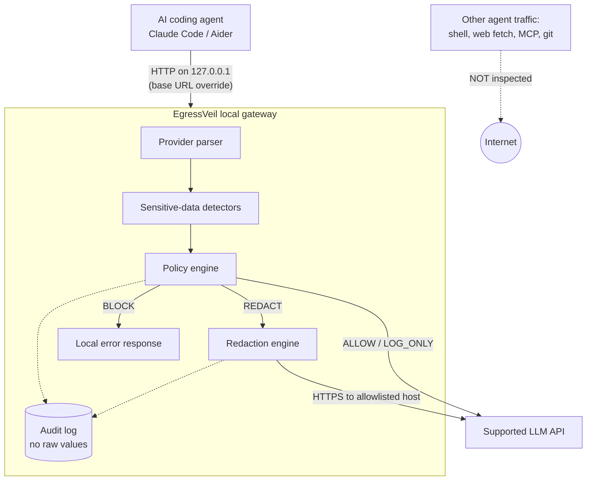

# EgressVeil

**The local privacy gateway for AI coding agents.**

[](https://github.com/qmmughal/egressveil/actions/workflows/ci.yml)
[](LICENSE)

EgressVeil is a local-first, open-source security gateway. It detects sensitive
information in the API traffic that supported AI coding agents send to LLM
providers, and redacts or blocks it before it leaves your machine.

> **Project status: pre-alpha (Phase 0).** This release has the project
> foundation: configuration schema and validation, the CLI, and an
> environment doctor. **The gateway does not intercept, redact or block any
> traffic yet.** Do not rely on EgressVeil for data protection until a release
> says that it does.

---

## Why

AI coding agents read your working tree and send large parts of it to a
remote LLM API. That context can contain `.env` files, cloud credentials,
customer data pasted into a test fixture, or internal hostnames. Today the
only control most teams have is to hope that none of it gets read.

EgressVeil sits between the agent and the provider API on `localhost`. It
inspects each request, applies a policy you control (`ALLOW`, `REDACT`,
`BLOCK`, `LOG_ONLY`), and writes an audit trail that never contains the raw
secret.

## What EgressVeil is not

- **It is not a firewall for everything your agent does.** It inspects only
  the LLM API traffic that a supported agent sends through it. Shell commands,
  package installs, web fetches, MCP servers, git pushes and other network
  activity from the agent or its tools are **not** covered.
- It cannot inspect traffic that an agent sends straight to a vendor backend
  that you can't redirect, which affects Cursor in particular (see
  [Integrations](#integration-compatibility)).
- It is not a replacement for keeping secrets out of your repository.

See [docs/threat-model.md](docs/threat-model.md) for the full scope.

## Features

### Implemented (Phase 0)

| Feature | Notes |
| --- | --- |
| `egressveil` CLI | `version`, `config validate`, `doctor` |
| Strict YAML configuration schema | Rejects unknown keys and wrong types, and validates numeric bounds |
| Secret-safe validation output | Messages name the location of a problem, never the value. Files that contain credential-shaped strings are rejected |
| Secure-by-default settings enforced at validation | Loopback-only listener, https-only allowlisted upstreams, strict (fail-closed) mode, no raw-value audit logging, no telemetry |
| Environment doctor | Checks Python, config, the listen port, the audit location, proxy and base-URL environment variables (values hidden), and agent CLIs on `PATH` |
| Cross-platform | Windows, Linux, macOS. No shell dependency |

### Planned

| Feature | Phase |
| --- | --- |
| Local HTTP gateway for the Anthropic Messages API, with streaming | 1 |
| Secret and token detectors (pattern plus entropy, with low false positives) | 1 |
| Policy engine (`ALLOW` / `REDACT` / `BLOCK` / `LOG_ONLY`) | 1 |
| Redaction with stable placeholders | 1 |
| JSONL audit log with keyed hashes and no raw values | 1 |
| OpenAI-compatible API parser (for Aider) | 2 |
| PII and internal-hostname detectors | 2 |
| `egressveil run -- <agent>` launcher that sets base URLs | 2 |
| OpenClaw integration | 3 |
| Cursor: documented, experimental support where technically possible | 3 |

The details are in [docs/roadmap.md](docs/roadmap.md).

## Security architecture



Built-in controls (the design is in [docs/security-design.md](docs/security-design.md)):

- **Local-only listening** by default. Binding to a non-loopback address needs
  an explicit opt-in.
- **Provider endpoint allowlisting**. Upstreams must be `https://` hosts on a
  per-provider allowlist.
- **Detection** of secrets, tokens, PII and internal hostnames *(planned)*.
- **Policy actions**: `ALLOW`, `REDACT`, `BLOCK`, `LOG_ONLY`.
- **Fail closed** in strict mode. Requests that EgressVeil can't parse or
  inspect are blocked *(planned; strict mode is the validated default)*.
- **Safe audit logging**. Raw values are never written, and config that asks
  for them is rejected.
- **No telemetry**. None exists, and `telemetry.enabled: true` is rejected.
- **No automatic restoration** of redacted secrets into model output that
  becomes an executable tool call.
- **Bounded memory**. Request bodies and streaming buffers have configurable
  hard limits.
- **Documented bypass limitations**. See [docs/integrations.md](docs/integrations.md).

## Installation

EgressVeil requires Python 3.11 or newer. It is **not yet published on PyPI**,
so install it from source:

```bash
git clone https://github.com/qmmughal/egressveil.git
cd egressveil
python -m venv .venv
# Windows:      .venv\Scripts\activate
# Linux/macOS:  source .venv/bin/activate
python -m pip install -e .
```

For development, install with `".[dev]"` instead (see [CONTRIBUTING.md](CONTRIBUTING.md)).

## Usage

```console
$ egressveil --help
$ egressveil version
egressveil 0.1.0.dev0
```

Validate a configuration file. The output never includes values that could
be secret:

```console
$ egressveil config validate --config configs/egressveil.example.yaml
Config source: configs/egressveil.example.yaml (--config)
Configuration is valid (0 warning(s)).
Effective settings:
  gateway.listen                       127.0.0.1:8787
  gateway.mode                         strict
  ...
```

An insecure setting is rejected with its location:

```console
$ egressveil config validate -c bad.yaml
Config source: bad.yaml (--config)
  error: gateway.listen_host: must be a loopback address (127.0.0.1, ::1 or localhost); set gateway.allow_non_loopback: true to override
Configuration is INVALID (1 error(s)).
```

Check your environment:

```console
$ egressveil doctor
egressveil 0.1.0.dev0 doctor
  [OK  ] python       3.12.2 (CPython)
  [OK  ] config       built-in defaults: valid
  [OK  ] listen port  127.0.0.1:8787 is available
  [INFO] claude code  'claude' found on PATH; ANTHROPIC_BASE_URL not set
  ...
0 failure(s), 0 warning(s).
```

Configuration is discovered in this order: `--config PATH`, then
`$EGRESSVEIL_CONFIG`, then `./egressveil.yaml`, then the user config directory
(`%APPDATA%\egressveil\` on Windows, `~/Library/Application Support/egressveil/`
on macOS, `~/.config/egressveil/` on Linux), and finally the built-in defaults.
All options are documented in
[configs/egressveil.example.yaml](configs/egressveil.example.yaml).

## Integration compatibility

| Agent | Status | Routing mechanism | Coverage |
| --- | --- | --- | --- |
| **Claude Code** | Initial priority, Phase 1 | `ANTHROPIC_BASE_URL` pointing to the local gateway | Anthropic API calls only. Not tool, shell, web or MCP traffic |
| **Aider** | Initial priority, Phase 2 | Provider base-URL settings (for example `--openai-api-base`, `ANTHROPIC_BASE_URL`) | LLM API calls only |
| **OpenClaw** | Future | To be determined | Not supported yet |
| **Cursor** | Limited and experimental | Most model traffic goes through Cursor's own backend | Expected to be partial at best. See the docs |

Nothing in this table works yet. The Status column is the target phase for
each integration. Routing details and their limitations are in
[docs/integrations.md](docs/integrations.md).

## Security limitations

- **Phase 0 does not protect any traffic.**
- Coverage is limited to API calls that a supported agent sends to the
  gateway. An agent, plugin or tool that ignores the base-URL setting, or that
  makes its own network calls, bypasses EgressVeil.
- Detection is heuristic. Both false negatives and false positives will
  happen. Treat EgressVeil as defense in depth, not a guarantee.
- EgressVeil does not perform TLS interception and does not install a root CA.
- A local process running as your user can reconfigure or bypass EgressVeil.
  It does not defend against malware on your machine.

To report a vulnerability, see [SECURITY.md](SECURITY.md).

## Roadmap

| Phase | Focus |
| --- | --- |
| **0, current** | Repository, packaging, CI, config schema, CLI, doctor, threat model |
| 1 | Anthropic gateway for Claude Code: streaming proxy, secret and token detectors, policy, redaction, audit |
| 2 | OpenAI-compatible parser for Aider, PII and hostname detectors, agent launcher |
| 3 | OpenClaw, experimental Cursor support, policy packs |

See [docs/roadmap.md](docs/roadmap.md).

## Contributing

Contributions are welcome. Please read [CONTRIBUTING.md](CONTRIBUTING.md) and
the [Code of Conduct](CODE_OF_CONDUCT.md). Never include real credentials in
issues, tests or fixtures.

## License

[MIT](LICENSE) © 2026 EgressVeil contributors.
